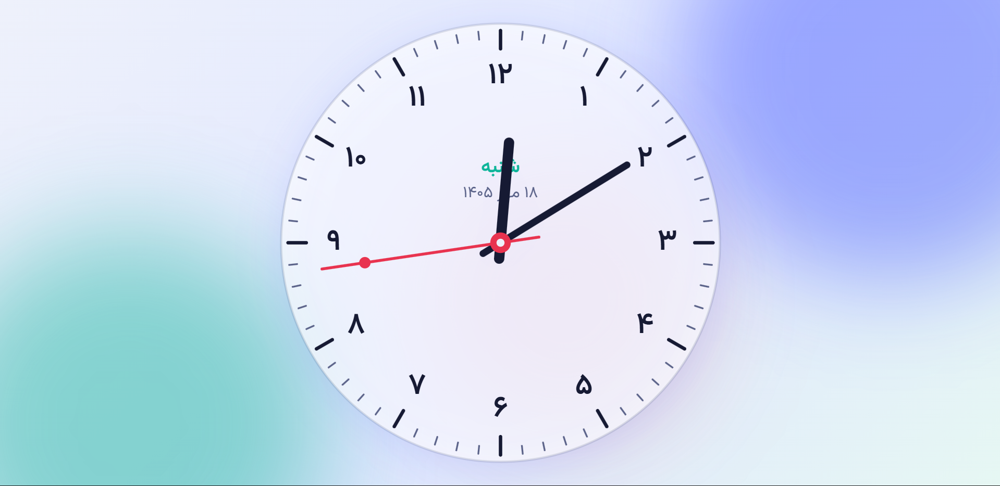
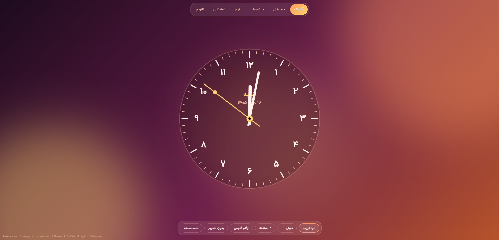
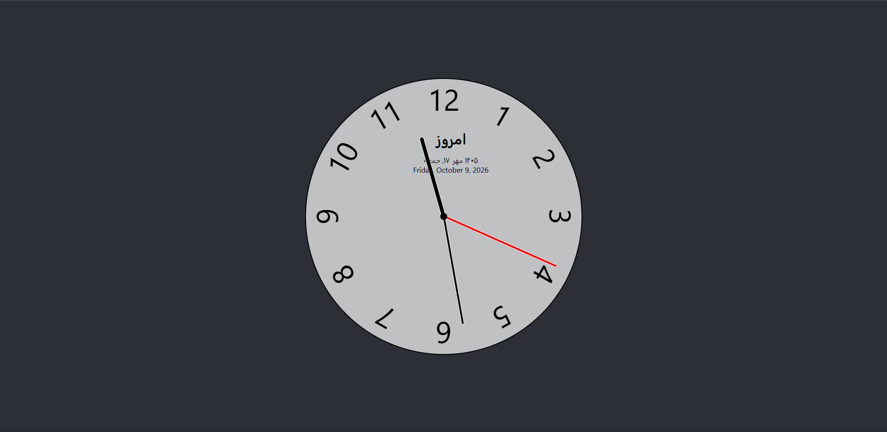
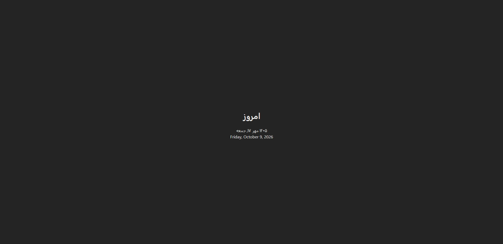

# تاریخ و ساعت فارسی

یک صفحهٔ تک‌فایلی (HTML + CSS + JS، بدون وابستگی و بدون ساخت) برای نمایش ساعت و تاریخ شمسی، میلادی و هجری قمری در چند حالت مختلف.

## اجرا

1. فایل `persian-clock.html` را مستقیم در مرورگر باز کنید.
2. برای انتشار روی سایت، آن را با نام `index.html` روی هاست قرار دهید (مثلاً `fa-date.onfing.ir`).

## حالت‌های نمایش

| کلید | حالت | توضیح |
|---|---|---|
| `1` | آنالوگ | عقربه‌های نرم، عددهای صاف، روز هفته و تاریخ شمسی روی صفحه |
| `2` | دیجیتال | عدد درشت، ثانیه، سه تقویم، نوار پیشرفت روز |
| `3` | حلقه‌ها | سه حلقهٔ ساعت، دقیقه و ثانیه |
| `4` | باینری | نمایش BCD با نقطه‌های درخشان |
| `5` | نوشتاری | زمان به حروف فارسی و بخش روز (صبح، ظهر، عصر، شب) |
| `6` | تقویم | تقویم کاغذی رومیزی که ورق می‌خورد |

### تقویم کاغذی

- هر روز نیمه‌شب، برگ امروز به‌صورت خودکار ورق می‌خورد.
- با کلیک یا تاچ روی برگ، یا با دکمه‌های «روز قبل» و «روز بعد»، یا با کلیدهای `←` و `→` می‌توانید روزها را ورق بزنید.
- دکمهٔ «امروز» شما را به تاریخ جاری برمی‌گرداند.
- اگر سیستم روی «کاهش انیمیشن» تنظیم شده باشد، ورق بدون انیمیشن عوض می‌شود.

## حالت بی‌حرکتی

اگر چند ثانیه موس حرکت نکند یا کاربر صفحه را لمس نکند:

- نوار تب‌ها (بالا) و نوار کنترل‌ها (پایین) محو می‌شوند.
- ساعت یا تقویم بزرگ‌تر می‌شود و صفحه را پر می‌کند.
- با اولین حرکت موس، لمس یا فشردن کلید، همه‌چیز برمی‌گردد.

مدت زمان انتظار را با ثابت `IDLE_MS` (بر حسب میلی‌ثانیه) در ابتدای اسکریپت تغییر دهید. پیش‌فرض `4000` است.

## امکانات مشترک

- **تم‌ها:** شب، روز، نئون، غروب، شفق
- **منطقهٔ زمانی:** تهران، باکو، دبی، استانبول، لندن، پاریس، نیویورک، توکیو، UTC
- **قالب ساعت:** ۱۲ یا ۲۴ ساعته
- **ارقام:** فارسی یا لاتین
- **تمام‌صفحه** و **ذخیرهٔ خودکار تنظیمات** در مرورگر (`localStorage`)

## میان‌برهای صفحه‌کلید

| کلید | عمل |
|---|---|
| `1` تا `6` | تغییر حالت |
| `T` | تغییر تم |
| `H` | ۱۲ یا ۲۴ ساعته |
| `D` | ارقام فارسی یا لاتین |
| `B` | تصویر پس‌زمینهٔ بعدی |
| `F` | تمام‌صفحه |
| `←` / `→` | روز بعد یا قبل (در حالت تقویم) |

## سفارشی‌سازی

- رنگ‌ها و تم‌ها: متغیرهای CSS در بالای فایل (`--accent`، `--accent2`، `--sec` و غیره)، هر تم یک بلوک `body[data-theme="..."]` دارد.
- شهرها: آرایهٔ `TZS`
- حالت‌ها: آرایهٔ `MODES` و بخش‌های `<section class="view">`

## سازگاری

مرورگرهای مدرن (Chrome، Edge، Firefox، Safari) به‌دلیل استفاده از `Intl.DateTimeFormat` با تقویم‌های `persian` و `islamic-umalqura`، و `container queries` برای اندازهٔ برگ تقویم.

